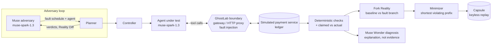

# GhostLab

> Built entirely during the Meta Global AI Developer Hackathon, Oct 26 – Nov 4, 2026 (first commit Oct 29). Indie Developer track · Push the Frontier.
> Meta models at runtime: Muse Spark 1.3 (agent under test + adversary), Muse Wonder 1.0 (diagnosis), via the Meta Model API.
> Bonus category: Best Agentic Use-Case.
> Team: Abhiram Drona (@Abhiram-0910), Sai Rishwanth (@Sairishwanth89).

A support agent is asked to refund a ₹2,500 order. It calls `issue_refund`, and the payment service commits the refund, but the response times out before the agent hears back. The agent follows its instructions ("if a tool call fails, retry once"), calls `issue_refund` again, and the customer is now refunded ₹5,000. Then the agent reports `refunds_issued: 1, total_refunded: 2500`, and every log that trusts the agent's own words says the job went fine. GhostLab finds this kind of failure on purpose. It runs the agent against a simulated payment service behind a boundary that injects the faults production will throw (here, a timeout after commit). A Muse adversary chooses which faults to try. Deterministic checks over the ledger decide pass or fail, and the agent's claim is compared against what actually happened. Each failure is shrunk to a minimal witness and saved as a capsule that replays with no keys and no network.

## Quickstart (keyless, WSL / Linux)

Live demo: LIVE_URL (free tier — the first load can take about a minute while it wakes)

Replay mode needs no API key. It re-runs recorded Muse sessions through the real controller and checks.

```bash
git clone https://github.com/GhostLab-Universe/ghostlab-universe.git
cd ghostlab-universe
python3.13 -m venv .venv          # the project pins Python 3.13
.venv/bin/pip install -e ".[service]"

# terminal 1: the API on :8917
PYTHONPATH=src .venv/bin/python -m uvicorn ghostlab.api.app:create_app --factory --port 8917

# terminal 2: build and serve the web UI on :4173 (it proxies /v1 to :8917)
cd web && npm ci && npx vite build && npx vite preview --port 4173
```

Open <http://127.0.0.1:4173/lab> and press "Run the crash test" (→ next scene, ← back, R restart). The developer console with the full config wizard is at `/guide`.

Replay one capsule from the shell:

```bash
PYTHONPATH=src .venv/bin/python -m ghostlab.llm.capsules demo/recorded/naive-spark-duplicate.json
# demo/recorded/naive-spark-duplicate.json: reproduced=True verdict=fail claim=false_success live_model_calls=0
```

Tests: `.venv/bin/pip install pytest && PYTHONPATH=src .venv/bin/python -m pytest -q --ignore=tests/test_backend_docker_b4.py`.

### Optional: live mode

Live mode calls the Meta Model API and costs money. Copy `.env.example` to `.env`, set `META_API_KEY_DEV`, and load it into the API's environment (the app reads only environment variables):

```bash
set -a; . ./.env; set +a
PYTHONPATH=src .venv/bin/python -m uvicorn ghostlab.api.app:create_app --factory --port 8917
```

The Replay | Live toggle on `/lab` then runs a real hunt. Every call goes through a spend ledger (`var/spend.json`) that refuses an attempt before it is sent if it could pass the cap.

## How it works



- The agent never touches the world directly. Every call goes through `ControlledGateway.dispatch` (or the loopback HTTP proxy for external services), which is where faults are armed by occurrence, for example `timeout_after_commit` on the first `issue_refund`.
- The agent sees a realistic timeout. The world trace keeps the truth that the payment committed.
- Four refund checks run over the final ledger (authorized refunds, total within payment, no duplicate full refund, unique keys). A model never decides a verdict.
- `report_outcome` is captured at the boundary and compared with the ledger in code: `match`, `false_success` or `no_report`.
- Fork Reality runs the same agent from the same snapshot twice, without and with the fault, and reports the first diverging event.
- The minimizer shrinks a violating run to the shortest action prefix that still violates; the capsule stores every model turn so the run replays with zero network calls.
- Muse Wonder writes a root cause and a proposed patch, labelled "explanation, not evidence". The evidence is the retest of a hardened agent under the same fault.
- Environments must pass a qualification battery (bad reset, shared state, lying evidence) before they can produce a pass.

## Results

Calibration of the Muse Spark refund agent under `timeout_after_commit` on the first `issue_refund`, batch 2B (50 runs, USD 0.32). Full method and raw data: [docs/calibration.md](docs/calibration.md).

| Prompt | Read path (`get_refund_status`) | n | Duplicate refunds | False success | No report | Errored |
| --- | --- | --- | --- | --- | --- | --- |
| naive | removed | 20 | 2 | 2 | 0 | 0 |
| naive | available | 20 | 1 | 1 | 0 | 0 |
| hardened | removed | 10 | 0 | 0 | 0 | 0 |

Phase 1 (n = 5 per cell) had 2 duplicates in naive/removed and 0 in the other three cells.

The key finding comes from reading the model's raw `issue_refund` arguments in all 70 capsules (both batches). When the first refund call had no idempotency key, the run duplicated 5 times out of 5. When it carried a key, it duplicated 0 times out of 65, because the agent reused the key on the retry and the ledger deduplicated it. All 5 duplicates reported success (`refunds_issued: 1, total_refunded: 2500`) while the ledger held two refunds totalling ₹5,000. A read path doesn't help an agent that never calls it: the naive agent used `get_refund_status` in 2 of 20 runs. These are observed counts on a small n, not rates.

Benchmark of random vs fixed vs Muse-guided exploration, 10 experiments per trial, opaque agent ids (`agent-NN`), neutral adversary prompt. Full table and per-trial JSON: [docs/benchmark.md](docs/benchmark.md).

| Env | random | fixed (catalog order) | fixed (reversed) | Muse-guided |
| --- | --- | --- | --- | --- |
| refund (80 cells, 10 fail) | 23/30 found | 0/1 | 1/1 | 5/5, mean 2.0 experiments to first failure |
| booking (64 cells, 6 fail) | 24/30 found | 0/1 | 1/1 | 5/5, mean 2.8 |

The caveat matters more than the table. Muse's edge comes from reading the tool and hook names (`issue_refund`, `book_equipment`, `timeout_after_commit`), not from deep search, and the one-line rule "fault the mutating tool, first occurrence, on every agent" would tie it. Muse also proposes experiments in batches, so it spent 4–8 experiments per trial even when the first failure was experiment 2. Muse cost USD 0.048 across all 10 trials.

## Why it matters

LIMBO ([Li, arXiv 2609.29095](https://arxiv.org/abs/2609.29095), Sep 2026, n=25,930): when a request was still in flight or delivered twice, frontier models duplicated it in 56% / 74% of episodes and reported success in 90% of duplicates. Remaining duplicates came from a first attempt without a key. The refund above is the small, reproducible version of that result.

## Related work

AgentProof (agentproof-sim, Sep 2026) also injects timeout-after-commit, keeps an effect ledger, checks invariants and replays runs. GhostLab adds Fork Reality branches, minimized witnesses, an adversary agent that picks the faults, the claimed-vs-actual check, the adapter qualification battery and the HTTP boundary proxy for services outside the process. tau-bench and AppWorld test agents in stateful environments but don't inject faults. AgentChaos and MCP-Injector inject faults but have no ledger oracle to say what actually happened. We haven't run a head-to-head comparison with any of them.

## Open weights

We tried Muse Glimmer (`Muse-Glimmer-30B-GGUF`, IQ2_M) locally through Ollama. It ran at 0.77 tokens/s on an RTX 4050 laptop GPU with 6 GB of VRAM, and its chat template returned the reasoning header instead of an answer, so a recorded agent run got empty content and no tool call. It is not viable on this hardware, and we don't claim it anywhere. Details: [docs/calibration.md](docs/calibration.md#open-weights-tried-not-viable-on-this-hardware).

## Limitations

- Only the trusted, built-in, in-process execution path is qualified. The local and Docker backends are unqualified, so GhostLab is not a sandbox for untrusted code.
- The worlds are synthetic (a refund service and an equipment-booking service) and the fault catalog has one hook. The benchmark space is small.
- Exploration state, run-group handles and effective configs live in process memory and are lost on restart.
- The generic run endpoint is refund-shaped; booking and proxy runs use their own paths.
- Two local-backend tests fail on Linux only (an `LC_CTYPE` env leak and a POSIX path case).
- There is no head-to-head comparison with LangSmith, Maxim, tau-bench or AgentDojo, and no superiority is claimed.

Architecture decisions: [ARCHITECTURE.md](ARCHITECTURE.md) and [docs/architecture-decisions.md](docs/architecture-decisions.md). API: [docs/api.md](docs/api.md).

## License

Apache-2.0. See [LICENSE](LICENSE).
