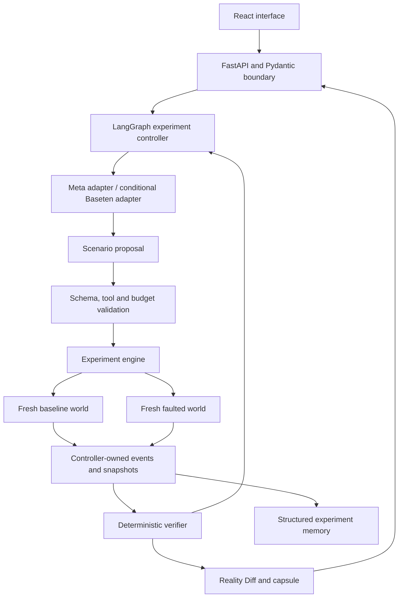

# GhostLab architecture and Meta compatibility

Decision record, 29 October 2026. The baseline is **React with Vite and TypeScript, FastAPI with Pydantic, LangGraph with custom provider nodes, and SQLite for the local MVP**. Direct Meta Responses is the primary planned inference adapter; Baseten is a conditional fallback with its own protocol adapter. The engine, verifier and replay remain independent of model libraries. This architecture is decided; authenticated compatibility and implementation are separate gates. The first executable refund slice is built and tested locally: baseline refunds 250000 paise, the faulted vulnerable run refunds 500000, the repaired run refunds 250000, Reality Diff identifies event 2 as the first divergence, and recorded replay matches without model calls. Core tests passed; no live Meta integration, LangGraph workflow, FastAPI service, interface or database persistence is implemented yet.

## The product is an executable experiment laboratory

GhostLab serves developers whose agents call stateful tools. In the first world, a synthetic INR 2,500 refund commits successfully, but the agent receives a timeout. GhostLab compares normal execution with that fault, detects whether a retry creates a duplicate refund, records the divergence and checks a repaired adapter. Done means the failure and repair can be reproduced from a capsule without a new model request. The first build excludes real payments, arbitrary uploaded agent code, production records and automatic patch execution. Its largest external risk is usable access to the required hackathon model. Its largest engineering risk is confusing a graph checkpoint with a reproducible world snapshot.

Synthetic fixtures are the subject of the simulation. Their ledger transitions and checks must execute. They are never presented as real payment activity, live model decisions or measured production failures. Model-guided exploration adds value when it chooses useful experiments and explains evidence; deterministic code retains responsibility for actions and verdicts.

The stack has one orchestration framework. LangGraph supports explicit nodes, conditional execution and persisted state without requiring LangChain. LangChain's higher-level agent harness is useful for general agents, but GhostLab needs a controlled experiment graph with visible budgets and verifier feedback. WorldSmith, Explorer and Analyst are logical roles within that graph, not three independently running agent systems. This keeps their prompts and responsibilities separate without introducing another coordination layer. ([LangGraph overview](https://docs.langchain.com/oss/python/langgraph/overview), [Graph API](https://docs.langchain.com/oss/python/langgraph/graph-api))

## Modules have clear authority and shared contracts

| Module | Responsibility | Initial boundary |
| --- | --- | --- |
| Contracts | Versioned scenarios, actions, events, runs, diffs and capsules | Pydantic at service/model boundaries; simple core data types internally |
| Refund world | Orders, customer ownership, ledger and idempotency identities | `get_order`, `issue_refund`, `get_refund_status` |
| Target adapters | Deterministic vulnerable/repaired agents, then model-driven agent | Same action and observation protocol |
| Experiment engine | Independent world instances, fault schedule, budgets and event order | Experiment specification in; run result out |
| Verifier | Duplicate, total-refund and authorization invariants | Read controller-owned evidence; compute verdicts |
| Evidence and replay | Snapshots, traces, hashes, capsule import/export and replay | Versioned JSON plus SQLite metadata |
| Reality Diff | First divergent event and resulting state changes | Compare baseline and fork evidence |
| Planner | LangGraph hypothesis, proposal, feedback and stop loop | Validated scenario proposals only |
| Providers | Meta Responses and conditional Baseten Chat Completions | Normalize messages, tool calls, usage and errors |
| Policy and execution | Tool allowlist, schema checks, quotas and execution backend | Trusted local backend first |
| Service | Create, inspect, replay, compare and cancel runs | FastAPI/OpenAPI; credentials remain server-side |
| Interface | Campaign status, trace, Reality Diff and replay controls | React/Vite/TypeScript; consume the service contract |

FastAPI provides OpenAPI and Pydantic request/response validation. Pydantic strict validation limits accidental coercion; it does not establish customer authorization or financial correctness. Those checks live in the world and verifier. The frontend selection is a project engineering decision, rather than a claim that Meta requires React. ([FastAPI features](https://fastapi.tiangolo.com/features/), [Response models](https://fastapi.tiangolo.com/tutorial/response-model/))

The first tool registry contains only the three refund operations. GitHub remains the collaboration system, not a tool exposed to the tested refund agent. Generic shell, arbitrary HTTP, unrestricted SQL and real payment connectors are excluded. WorldSmith later proposes world specifications and candidate invariants for developer review; generated code does not become executable authority merely because a model produced it.

## Meta compatibility is documented and then tested per endpoint

Direct Meta documentation identifies base URL `https://api.meta.ai/v1`, environment key `MODEL_API_KEY` and model `muse-spark-1.3`. The planned primary adapter uses Responses, including the documented continuation mechanism to preserve reasoning continuity. Provider continuation state stays opaque; the product displays tool evidence and verifier findings, not reconstructed hidden reasoning. ([Meta Responses](https://dev.meta.ai/docs/protocols/responses))

Responses and Chat Completions require distinct serializers. Responses uses flat function definitions, `function_call` items and `function_call_output` paired by `call_id`. Chat Completions nests function definitions under `function`, returns `tool_calls` and pairs `tool` results using `tool_call_id`. The engine receives a normalized internal action and never depends on either wire format. Meta strict structured output also has schema restrictions: use a simple object root, explicit required fields and `additionalProperties: false`; validate the result locally after transport parsing. ([Meta tool calling](https://dev.meta.ai/docs/tool-calling), [Structured output](https://dev.meta.ai/docs/structured-output))

Baseten documents `https://inference.baseten.co/v1/chat/completions`, `BASETEN_API_KEY` and public model slug `meta-models/muse-spark-open`. The exact hackathon slug `meta-models/muse-spark-open-1026` comes from the announcement supplied in the earlier conversation and **was not independently verified in public official documentation**. The enabled, organizer-permitted deployment must be confirmed before it is selected. Fallback is explicit configuration, never a silent change of model mid-experiment. ([Baseten announcement](https://www.baseten.co/resources/changelog/muse-spark-open-and-nemotron-35-super-vl-available-on-baseten/), [Chat Completions reference](https://docs.baseten.co/reference/inference-api/chat-completions))

LangGraph can stream from a raw model client, so it does not require a Meta-specific LangChain integration. A generic `ChatOpenAI` custom base URL is insufficient evidence of full parity: its handling of nonstandard fields can omit provider information. Custom adapters preserve the actual protocol and keep provider-specific reasoning controls out of shared application logic. ([LangGraph streaming](https://docs.langchain.com/oss/python/langgraph/streaming), [LangChain provider documentation](https://github.com/langchain-ai/docs/blob/main/src/oss/concepts/providers-and-models.mdx))

| Integration | Documentary finding | Operational status |
| --- | --- | --- |
| Direct Meta Responses | Documented protocol, model, auth and continuation | No authenticated call tested |
| Meta tools and strict output | Documented formats and restrictions | Roundtrip/schema probes pending |
| Baseten standard model | Public endpoint and model documented | Account/model access untested |
| Baseten `-1026` deployment | User-supplied announcement | Exact availability unverified |
| LangGraph custom nodes | Raw API clients and persistence documented | Dependency resolution/integration pending |
| NeMo Guardrails | Custom providers/endpoints documented | Meta configuration untested |
| OpenShell | Policy isolation documented; Windows limitations documented | Deferred; no enforcement test |

Before enabling live exploration, produce a redacted `compatibility-report.json` with provider, endpoint, exact model, date, dependency versions and results. Test minimal authentication; a harmless tool-call/result roundtrip; valid and invalid structured proposals; continuation after a tool result; and usage capture. Separately test streamed partial tool arguments before enabling streaming. Cancellation, timeouts, rate limits, malformed output and exhausted budgets must terminate without accidentally repeating a committed world action. Keep failed capability checks visible. No API keys were read and no live inference was run during this research.

## Memory preserves experiments without contaminating worlds

There are three different stores: graph working state, cross-run experiment findings and authoritative execution evidence. LangGraph checkpoints carry a campaign's current hypothesis, budget and artifact references. Structured experiment memory stores attempted scenarios and outcome signatures by project and world version. Evidence stores the initial fixture, event sequence, final snapshots and invariant versions. SQLite supports the serial local coordinator; the hosted multiworker service moves application storage and checkpoint persistence to Postgres. A vector database and embedding service add no necessary capability to the initial structured corpus. ([Persistence](https://docs.langchain.com/oss/python/langgraph/persistence), [Stores](https://docs.langchain.com/oss/python/langgraph/stores))

**LangGraph replay is not Failure Capsule replay.** Resuming from a checkpoint can rerun model/API nodes and side effects. A graph checkpoint also does not clone an external database or container. Each baseline and fork therefore starts from the same immutable fixture in separate world instances. Capsule replay loads recorded decisions and ordering, or a deterministic adapter, against reset state and makes no new inference request. A fresh model invocation is labeled a new experiment even when its prompt and seed match. ([Checkpointers](https://docs.langchain.com/oss/python/langgraph/checkpointers), [Re-execution and idempotency](https://docs.langchain.com/oss/python/langgraph/graph-api#re-execution-and-idempotency))

Capsules carry schema/world/adapter versions, fixture, fault schedule, logical events, tool arguments/results, recorded model outputs when present, final state and expected checks. Stable serialization and hashes identify accidental changes; hashes alone do not authenticate hostile evidence. The controller owns event IDs and verification, while imported capsules are validated as data. Two collaborators share code through GitHub and each keeps a local database; a live SQLite file is never committed or synced as shared state.

## Engine enforcement comes before optional guardrail products

Mandatory controls are tool allowlists, validated parameters, customer ownership checks, bounded steps/calls/time/output, isolated run state, secret redaction and controller-owned verdicts. Deliberately vulnerable refund behavior is permitted inside the synthetic test world so the verifier can find it; host boundaries stay enforced. Malicious instructions inside a tool response remain untrusted data and cannot grant new tools or authority. NVIDIA's own integration guidance places authorization and validation in application APIs and treats model output as untrusted. ([NVIDIA security guidelines](https://docs.nvidia.com/nemo/guardrails/latest/resources/guidelines))

NeMo Guardrails is an optional application policy layer for inputs, outputs and tool content. OpenShell applies process, filesystem and network restrictions. They are complementary, not substitutes for each other or for the verifier. NeMo documents custom endpoints/providers, but its LangGraph example does not certify this Meta configuration; evaluate bypasses and benign false blocks on the chosen model before enabling it. ([NeMo supported LLMs](https://docs.nvidia.com/nemo/guardrails/latest/about-nemo-guardrails-library/supported-llms), [LangGraph integration](https://docs.nvidia.com/nemo/guardrails/latest/integration-with-third-party-libraries/langchain/langgraph-integration))

OpenShell is deferred from this Windows MVP's critical path: official documentation labels WSL2 plus Docker experimental, while native Windows MXC is under development and not production-qualified. Define one `ExecutionBackend` interface now. When arbitrary code becomes necessary, qualify one isolated backend with tests for denied network/filesystem access, absent credentials, resource limits, timeout termination and evidence integrity. Modal is an option, but outbound access is allowed by default and must be explicitly blocked when required. ([OpenShell support](https://docs.nvidia.com/openshell/about/support-matrix), [Installation](https://docs.nvidia.com/openshell/about/installation), [Modal networking](https://modal.com/docs/guide/sandbox-networking))

Implementation proceeds from the real refund simulation to replay, then live provider probes, bounded LangGraph exploration and the interface. Resolve exact dependency versions together in a clean environment, run meaningful checks and commit a lockfile; do not invent current version pins. Reopen a decision only when a recorded probe fails, a requirement changes or a dependency limitation is demonstrated. The local core now provides an executable duplicate-refund case, an idempotent repair and matching recorded replay. The next gate is an authenticated provider capability report before adding the live LangGraph experiment loop.
