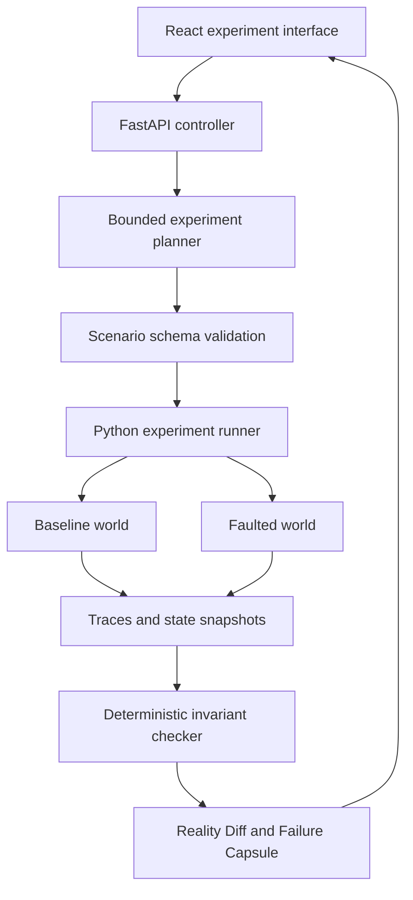

# Architecture

This is the proposed MVP design, not an implemented system.

## Experiment flow

1. Load a versioned world fixture and an agent adapter.
2. Run a baseline and record every tool request, response and state transition.
3. Restore the fixture into a separate world instance and apply one fault.
4. Execute the agent against the faulted world.
5. Run deterministic invariants against both ledgers.
6. Compare the traces and state to produce Reality Diff.
7. Export a Failure Capsule and replay it before reporting a reproducible failure.

## Components

| Component | Responsibility |
| --- | --- |
| World | Own synthetic orders, authorization rules and ledger transitions |
| Agent adapter | Expose a common step interface and capture decisions and tool calls |
| Fault injector | Apply declared faults at explicit operation boundaries |
| Runner | Enforce step, time and model-call budgets; isolate run state |
| Verifier | Evaluate invariants from recorded state without relying on model judgment |
| Planner | Propose the next experiment from observed outcomes |
| Capsule exporter | Package versioned inputs, recorded responses and expected checks |
| Interface | Display side-by-side traces, state differences and replay results |

## First world

Tools: get_order, issue_refund and get_refund_status. Use integer minor currency units. Refunds must be authorized, must not exceed the paid amount and must remain idempotent under retries.

The first seeded vulnerability retries with a new transaction identity after a timeout, even though the initial payment committed. The repaired adapter uses a stable idempotency key and checks status before deciding to retry.

## Replay contract

A capsule includes schema version, world version, fixture, fault schedule, seed, adapter version, configuration, trace and invariant results. Record model outputs for deterministic replay; a fresh model call is a new experiment and may produce different actions. Persist logical clock events and tool ordering rather than relying on wall-clock timing.

## Authority and limits

Generated scenarios are data validated against an allowlist. The runner controls mutations, tools and budgets. Model explanations cite trace event IDs; they cannot decide pass or fail. Repair suggestions are reviewed by a developer before execution. Start with trusted local adapters; local subprocesses are not a security boundary for arbitrary uploaded code.

## Deferred

WorldSmith generation, a second booking world, hosted isolation, production trace import and a public failure registry follow the refund MVP. Do not couple initial progress to cloud credits or provider approval.
