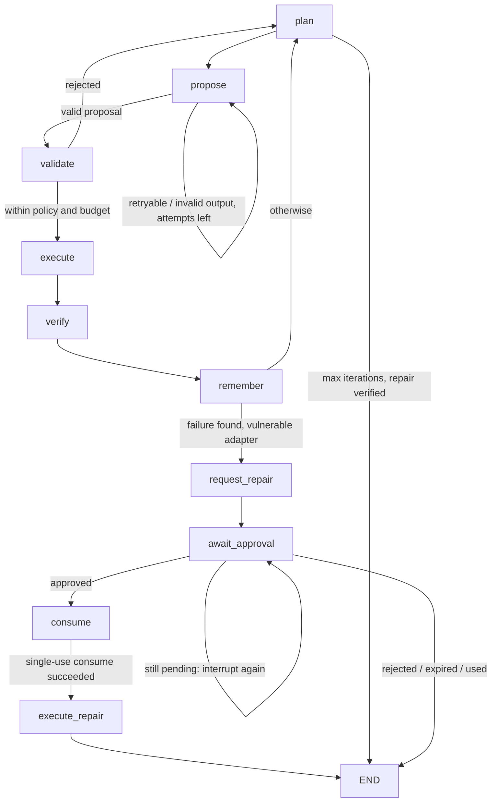

# M05 — Orchestration: roles, recovery and resource budgets

Interfaces published:

- `ghostlab-orchestration/1` (`src/ghostlab/orchestration/`)
- `ghostlab-budgets/1` (`src/ghostlab/budgets/`)

Base: `architecture-and-refund-core` at `cbf59d2` (M00, M01, M03, M04 and M06
merged).

It consumes these interfaces:

| Interface | From | Used for |
| --- | --- | --- |
| `ghostlab-contracts/1` | M00 | All records |
| `ghostlab-providers/1` | M01 | Explorer calls; `Runtime.attempt_gate` |
| `ghostlab-storage/1`, `ghostlab-storage-budgets/1`, `ghostlab-storage-artifacts/1` | M04 | Memory, approvals, ledger, artifacts |
| M04 `graph_checkpointer` | M04 | LangGraph `SqliteSaver` in its own file |
| M03 `ContextCompiler` / `SkillRegistry` | M03 | Explorer context bundles |
| `policy-1` | M06 | Scopes, tool authorization, ceilings, approvals |

The refund core (`ghostlab.core`, owned by M02) is used through its public
classes and is not edited.

## Graph

Any node can also stop with `cancelled`, `budget_exhausted` (naming the
resource) or `failed`. Routing is explicit: every node writes `next`, and one
router maps it to the next node. There is one orchestration framework
(LangGraph), with no LangChain agent, CrewAI or AutoGen loop.

### Roles

| Role | How it runs | Scope |
| --- | --- | --- |
| Supervisor | Deterministic controller code | Undelegated root scope from the trusted session; the only role that writes memory and requests approvals |
| Explorer | The configured Meta model through M01's real adapter | Delegated with **no tools**; isolated M03 context (`propose-refund-scenario` v1); must return `experiment_proposal/1` |
| Target | The checked-in vulnerable/repaired adapters (the system under test) | Delegated the three refund tools |
| Verifier | Deterministic `verify` and `reality_diff` | — |

A model can't approve itself, choose its scope or change a verdict.

### Trust boundaries

- **Authority comes from `TrustedSession(principal, project_id)`.** It is passed
  to the constructor (M07 will derive it from an authenticated session).
  `CampaignSpec` carries no identity. `state`, `record`, `resume`, `recover`
  and every guarded node refuse a campaign whose stored project or principal
  differs from the session.
- **No takeover.** Graph threads are namespaced as `<project>:<campaign>`, and
  `start` refuses an id that already exists in the project (`CampaignExists`).
  Another session can't restart a campaign or discard a paused approval.
  Budget ledger rows use the same `<project>:<campaign>` key (`ledger_key`),
  because M04's ledger has no project column.
- **Graph state is plain JSON** (contract dumps), re-validated through M00
  contracts at node boundaries. Checkpoints never hold library types.
- **The world actor comes from M06's `PrincipalBinding`.** Every world tool call
  goes through `authorize_tool`, using `PolicyEnforcedWorld`, a `RefundWorld`
  subclass. A denial raises before `RefundWorld.call`: no trace event and no
  ledger change. For allowed calls, the output equals `ghostlab.core.run`
  exactly (tested across adapters, faults and caps).

## Budget rules (`ghostlab-budgets/1`)

- **Ceilings:**
  - The campaign budget must fit M06's supervisor ceiling (`check_within_ceiling`).
  - Per-task role ceilings (`ceiling_for`) are also enforced: Explorer 5 calls
    and 5,000 output tokens per task; Target 20 tool calls per run.
- **Every outbound HTTP attempt, retries included,** reserves one `model_calls`
  unit, `max_output_tokens` (1,000) of `output_tokens`, and the bundle's
  estimated `input_tokens`.
  - Reservations go through M04's atomic ledger via `Runtime.attempt_gate`, on a
    fresh runtime and adapter per call.
  - The gate never raises. A refusal stops the call before sending, and the
    campaign ends `budget_exhausted`.
- **Reconciliation after each call:**
  - The final attempt uses the reply's reported usage.
  - Earlier attempts are reconciled as **unknown** (`None`), which keeps
    counting their full reservation.
  - Cost is never reserved. No price is verified, so cost stays `null`
    (unknown), not 0.
- **Tool calls:**
  - Each run reserves its scenario cap before the world is touched, and is
    reconciled to the actual trace length.
  - A proposal whose two runs would exceed the remaining tool budget, or the
    Target ceiling, is rejected and never executes.
- **Wall clock:** `max_wall_clock_ms` is checked at every guarded node.
- **No leaked reservations:** if a reservation is refused or a run raises (for
  example, an unbound principal), every tool reservation made for that step is
  released.
- **Concurrency:** baseline and fork run in parallel, up to `max_parallel_runs`.
  Reservations are atomic in the ledger (tested: 24 racing reservations against
  a ceiling of 7 yield exactly 7).
- **Restarts:** per-task counters live in process. After a restart a task gets a
  fresh counter, while the campaign ledger keeps every earlier reservation, so
  it may over-count but never under-counts.

## Recovery, idempotency and approvals

- **Checkpoints:** every super-step is checkpointed synchronously
  (`durability="sync"`) to M04's separate graph database.
- **`recover()` after a crash** continues from the last checkpoint. Completed
  nodes do not re-run.
  - Tested: a crash just before `verify` leaves the experiment runs and the
    model call unrepeated.
  - World runs start from a fresh immutable fixture, so a node re-run after a
    crash has no external side effect. Artifacts and memory use deterministic,
    content-checked identifiers.
- **Approval lifecycle:**
  1. `request_repair`: the supervisor requests an approval for the checked-in
     `repaired` adapter under the same fault, bound by digest to that exact
     action. The approval id is deterministic, so a re-run finds the existing
     request instead of creating a second one.
  2. `await_approval` interrupts the graph. Status is `awaiting_approval`, and
     the pause survives a restart.
  3. A human decides through M06 `ApprovalService.decide`, outside the graph,
     with their own session principal and project authority. The controller
     never decides.
  4. `resume()` re-checks the stored approval. **The resume payload is
     ignored.** Pending means pause again; rejected stops; expired is marked and
     stops.
  5. `consume` is its own checkpointed node. Only a successful single-use
     `ApprovalService.consume`, with the digest recomputed from the action about
     to run, authorizes `execute_repair`.
  6. A second resume, a replayed consume or a changed action cannot run the
     repair twice.
- **Retries:**
  - HTTP retries are M01's, bounded and budgeted per attempt.
  - Task-level retries (Explorer: 2 attempts) cover transient and
    invalid-output errors only.
  - A failure past its bounds ends the campaign `failed` with the error
    recorded.
- **Graph resume is not capsule replay.** Resuming can repeat a model call for
  an unfinished node. Failure Capsule replay re-executes recorded actions with no
  inference.

## Inference stays mocked

Only an `httpx.MockTransport` counts as mocked. `require_inference_allowed`
refuses every other runtime, whether the default network transport (`None`)
or a real `httpx.HTTPTransport`, unless the key comes from the environment
(`env:` credential source) and a `LiveInferenceAuthorization` provides all of:

- the exact model;
- an explicit spending cap (`max_model_calls`, which replaces the campaign
  value);
- `confirm_paid_calls`;
- a **live** M01 compatibility report for that model with every check `passed`.

Mock-labeled, wrong-model, skipped-check, unconfirmed and uncapped cases are
all refused (tested). No test builds a network runtime, and no live call has
been made.

## Validation (2026-10-29, Windows 11, CPython 3.13.18)

`tests/orchestration/` has 45 tests. They run against **real M04 SQLite stores**
in temporary directories, the real M01 Meta adapter, and a scripted
`httpx.MockTransport` (labeled fixtures).

| Area | What the tests check |
| --- | --- |
| Happy path | Failure found (250000 vs 500000 minor units, first divergence at event 2), verified memory written, paused for approval, approved, resumed, consumed once, repair verified (250000) |
| Approval failures | Resume without a decision; rejection; expiry; stranger, wrong-digest and controller-as-approver denied; a changed action fails to consume; a second resume does nothing |
| Restart and sessions | Pause survives a restart; another project or principal can't resume, read state, read the record or restart the campaign; crash-and-recover without repeated runs or model calls |
| Invalid input | An invalid proposal never executes; malformed output is retried within bounds |
| Provider errors and budgets | Provider errors are bounded (4 attempts, all accounted); the budget counts every HTTP attempt, so a retry beyond the cap is never sent; tool budget is reserved before runs |
| Stops | Cancellation; identity mismatch and unbound principal denied without mutation or open reservations; over-ceiling campaign refused |
| Units | Engine equals `ghostlab.core.run`; denials leave no trace; findings cite ledger events; reservations are atomic under contention; the gate never raises; per-task ceilings; task DAG waits and illegal transitions; live-gate refusals, including a real `HTTPTransport` and a non-environment key |

Results are in the PR description.

## Gaps and requests

- **New worlds and WorldSmith:** deferred to a separate M00/M02 contract
  extension. Only `refund-world/1` and its supported fault exist.
- **Analyst model step:** blocked on M00 publishing `evidence_interpretation/1`
  and `repair_suggestion/1`. Until then, the supervisor's repair request is
  deterministic code.
- **M02 wiring:** the policy-enforced runner mirrors `ghostlab.core.run`. If M02
  adds a policy hook to the core, M05 should switch to it; the equality test
  will catch any drift.
- **Cancellation hook:** M05 satisfies M01's `is_set()` proposal with a
  `threading.Event`. In-flight HTTP is still not interrupted (M01's limit).
- **Tasks and events live in graph state only.** There is no M04 table yet.
  M07/M08 can read them through `controller.state()`; persisting them for
  queries is a later M04 request.
- **Budget scope:** budget reservations are campaign-scoped, and M04's ledger
  has no project column (an M04/M00 gap). The controller only reserves for
  campaigns owned by its session.
- **Crash window around consume:** if the process crashes after
  `ApprovalService.consume` succeeds but before its checkpoint, recovery re-runs
  consume, which now fails (`not_approved`), and the campaign ends `failed`. It
  fails closed and never runs the repair twice, but it doesn't complete; a new
  approval is needed. This is the intended trade-off.
- **Deployment:** single local coordinator only. Multi-process workers and
  Postgres are not supported.
- **M07** will expose `start`, `resume`, `state` and `record`, and must build
  `TrustedSession` from authenticated sessions.
- **M09** should commit the cross-module evaluation suite and telemetry.
